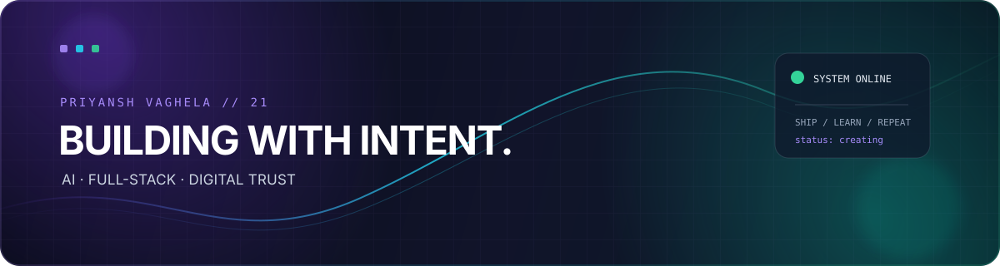

<div align="center">
  
</div>

<div align="center">

  <a href="https://github.com/priyanshvaghela21"></a>
  <a href="https://brandguard-zeta.vercel.app"></a>
  

</div>

<br />

<h1 align="center">Hi, I'm Priyansh 👋</h1>

<p align="center">
  <strong>AI product builder · Full-stack developer · Digital trust enthusiast</strong>
  <br />
  I turn ambitious ideas into useful, human-centred software — from intelligent health tools to safer digital brands.
</p>

<p align="center">
  <a href="https://github.com/priyanshvaghela21?tab=repositories">Explore my work</a>
  ·
  <a href="https://brandguard-zeta.vercel.app">Try BrandGuard</a>
  ·
  <a href="https://github.com/priyanshvaghela21">Let's connect</a>
</p>

---

## ✦ The short version

```text
I like the space where product thinking meets engineering.

→ Build        AI-powered products with a clear purpose
→ Care about  thoughtful interfaces, reliable systems and real-world impact
→ Currently   turning ideas into polished, deployable experiences
→ Signature   ship with intent; improve with every commit
```

## 🚀 Featured builds

<table>
  <tr>
    <td width="50%" valign="top">
      <h3>🛡️ BrandGuard</h3>
      <p>Autonomous pre-publication brand review and governance platform. It combines a deterministic rule engine with AI-assisted review, risk signals and role-based workflows.</p>
      <p>
        <a href="https://brandguard-zeta.vercel.app"><strong>Live demo ↗</strong></a>
        ·
        <a href="https://github.com/priyanshvaghela21/BrandGuard-AI">Source ↗</a>
      </p>
      <sub>React · Vite · FastAPI · Python · SQLite · Docker</sub>
    </td>
    <td width="50%" valign="top">
      <h3>🌿 AHI Health Index</h3>
      <p>AI-powered health assessment that turns lifestyle and health inputs into a personalised wellness score and practical recommendations inspired by Ayurvedic principles.</p>
      <p>
        <a href="https://github.com/priyanshvaghela21/AHI"><strong>View project ↗</strong></a>
      </p>
      <sub>JavaScript · AI · Health technology · Web + mobile</sub>
    </td>
  </tr>
</table>

## 🧰 My build stack

<p>
  
  
  
  
  
  
  
  
  
</p>

## 📊 GitHub at a glance

<div align="center">
  
  
</div>

<br />

<div align="center">
  
</div>

## 🧭 What I care about

| Signal | In practice |
| :--- | :--- |
| **Useful AI** | Technology should make a meaningful decision, workflow or experience better. |
| **Trust by design** | Safety, clarity and explainability belong in the product from day one. |
| **Crafted UX** | A powerful system should still feel simple, responsive and welcoming. |
| **Visible progress** | Small, consistent commits compound into ambitious products. |

<br />

<div align="center">
  <h3>Let's build something that matters.</h3>
  <a href="https://github.com/priyanshvaghela21?tab=repositories">Browse repositories →</a>
  <br /><br />
  <sub>Designed with curiosity · Built with intent · Shipped from India 🇮🇳</sub>
</div>
